# Nexus Admin: aplicação whitelabel em Blazor

Blazor Web App (.NET 11), Interactive Server, EF Core + SQLite, ASP.NET Core Identity, SignalR e Hangfire.


**Sumário:** [Produto](#produto) · [Funcionalidades](#funcionalidades) · [Segurança: sessões e MFA](#segurança-sessões-dispositivos-e-mfa) · [Relatórios](#relatórios-excel-e-pdf) · [Como rodar](#como-rodar) · [Arquitetura](#arquitetura) · [Fluxos de código](#fluxos-de-código) · [Pacotes](#pacotes-usados) · [Prints](#atualizando-os-prints)

## Produto

Painel administrativo **white label** para gerir pessoas, times e acessos de uma empresa:

| Para quem | O que resolve |
|---|---|
| **Administradores** | Cadastram usuários, papéis (roles) e times; bloqueiam contas; definem as regras de cadastro, sessão e notificação; exportam relatórios. |
| **Gestores de time** | Mantêm os membros do time e o papel de cada um; o time pode ter nome, logo e cores próprios. |
| **Usuários** | Entram com senha e, se quiserem, um 2º fator (app autenticador); veem e encerram suas sessões; recebem notificações em tempo real. |
| **Quem revende / implanta** | Troca nome, logo, cores, fonte e textos pela tela (whitelabel), sem recompilar. Interface em português, inglês e espanhol. |

Princípios: permissões **fixas no código** e papéis **dinâmicos** na tela; tudo que é lento ou pode falhar (e-mails, entregas, expirações) roda em **jobs com nova tentativa**; eventos de segurança chegam **na hora** pelo SignalR.

## Funcionalidades

> Prints capturados com os dados do seed, logado como `admin@demo.com`. Ficam em [`docs/screenshots/`](docs/screenshots).

### Login e contas de demonstração
Login em SSR estático com o whitelabel global. Ao clicar numa conta demo, os campos são preenchidos.


### Usuários: listagem, busca, ordenação e paginação
Tabela paginada no servidor, com busca com debounce, colunas ordenáveis e skeleton durante o carregamento.
Papéis e times longos são resumidos em **"… +N"**; ao passar o mouse, aparece a lista completa.


### Multi filtros
Papéis, times e departamentos (multi-seleção), status e período de cadastro.
Cada filtro ativo vira um chip removível. A URL aceita `?role=` e `?team=`.


### Dialog lateral (criar/editar)
Editor em drawer, com upload de avatar, validação (DataAnnotations no cliente **e** no servidor via pipeline do CQRS), papéis e times.

O seletor de times (`MultiSelect`) e o autocomplete (`LazyAutocomplete`) **rolam com a roda do mouse e com toque** mesmo dentro do drawer:
não há mais uma camada invisível por cima da página para detectar o clique fora. Quem fecha o painel é um observador em JS
(`OutsideClickWatcher` + `appDropdown.watch`), e o painel rola sozinho para ficar visível quando abre perto do rodapé.

| Editor | Times com rolagem no drawer |
|---|---|
|  | 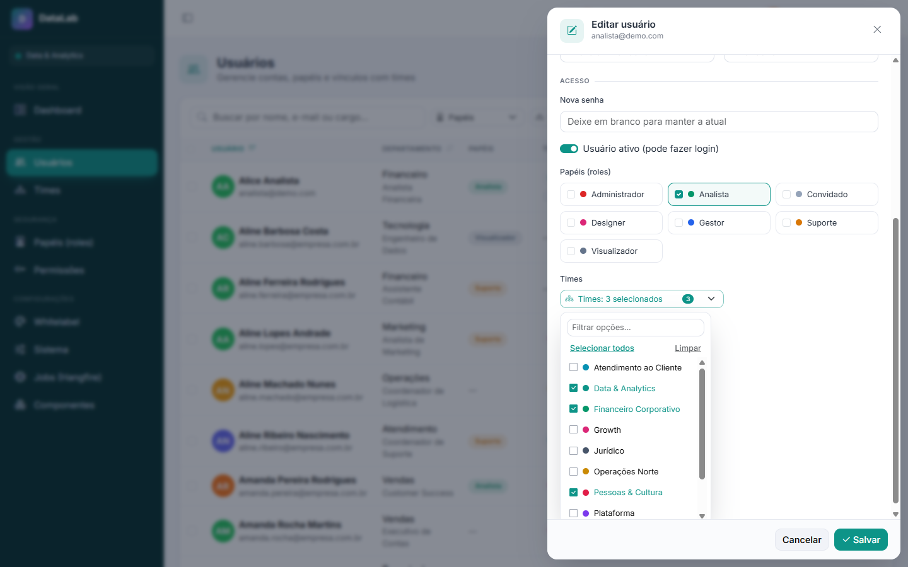 |

### Dialog central (detalhes)
Mostra também se o usuário tem MFA. Quem tem `Users.Edit` pode **remover o MFA** de outra pessoa (celular perdido); as sessões dela são encerradas.


### Confirmação de exclusão
Mostra o impacto da exclusão. Exclusões críticas, como a de um time, exigem digitar o nome.

| Simples | Crítica (digitar o nome) |
|---|---|
|  |  |

### Ações em lote
Selecione vários usuários para ativar, inativar ou excluir. A exclusão em lote pede confirmação digitada.


### Papéis (roles dinâmicas) e permissões (fixas)
Os papéis são criados pela tela. As permissões têm **Id e nome fixos no código** (`Perm`) e são sincronizadas no seed.
O editor mostra a matriz de permissões agrupada, com "marcar o grupo".

| Papéis | Matriz de permissões |
|---|---|
|  |  |

Catálogo das permissões, com os papéis que concedem cada uma:


### Times personalizados
Cards com a identidade visual de cada time. O editor define cores, logo e o **branding próprio** do time: nome exibido e cor do menu.

| Times | Editor do time |
|---|---|
|  |  |

### Membros do time e busca lazy
A busca de usuários para adicionar é paginada sob demanda ("carregar mais"), e o papel no time pode ser alterado na própria lista.


### Troca de time e branding aplicado
No menu **Meus times**, o time atual aparece no topo e com ✓. Ao escolher um time com branding próprio, a aplicação inteira assume o nome e as cores dele.

| Menu "Meus times" | Branding do time aplicado |
|---|---|
|  |  |

### Menu do usuário: permissões efetivas
As permissões efetivas são resumidas com **"… +N"**; ao passar o mouse, aparecem todas. O menu também leva à página **Segurança da conta**.


### Whitelabel
Nome, slogan, logo, favicon, cores (com temas prontos), fonte, arredondamento, efeito de transição de página e textos do login.
A pré-visualização atualiza enquanto você edita. O nome e a logo também vão para os relatórios e para o emissor do MFA no app autenticador.


### Componentes: toasts, loadings, dialogs, upload, busca lazy, paginação e efeitos
A página **Componentes** (`/components`) reúne todos os componentes reutilizáveis para teste.

| Toasts | Loading global |
|---|---|
|  |  |

### Idiomas (português, inglês e espanhol)
O seletor no topo (e no canto da tela de login) troca o idioma de toda a interface, incluindo mensagens de validação, erros de negócio, erros do Identity, toasts, relatórios e o formato de datas e números.
A escolha fica gravada em cookie.

| Inglês | Espanhol |
|---|---|
| 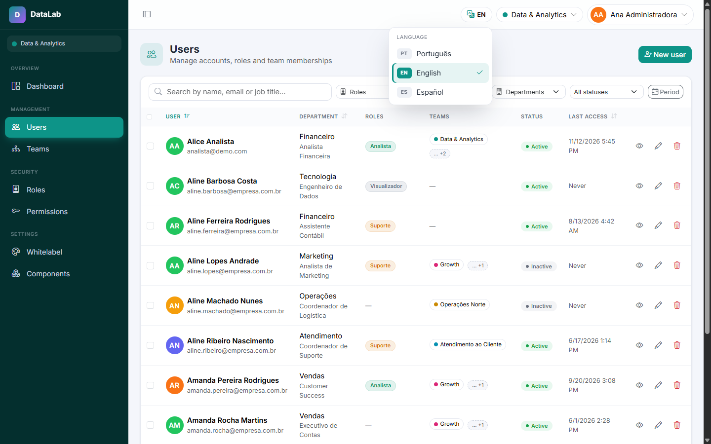 | 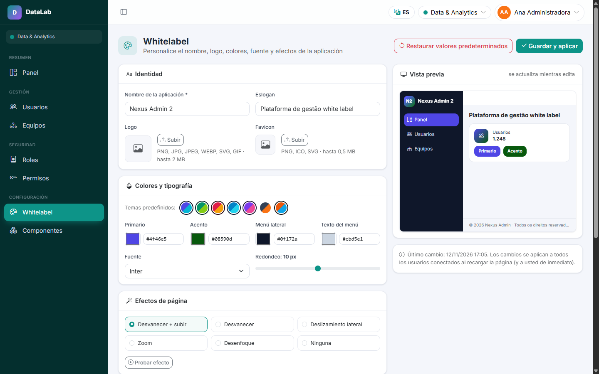 |

#### Valores monetários por idioma
Em **/components**, o card *Valores e moedas por idioma* tem um pedido de exemplo com preço, quantidade e desconto:
- **Moeda padrão por idioma:** real (R$) em português, dólar ($) em inglês e euro (€) em espanhol. O seletor permite trocar a moeda.
- **Entrada:** o componente `<MoneyInput @bind-Value="..." Currency="BRL" />` aceita o valor digitado no formato do idioma (`2.500,75` ou `2,500.75`) e o reformata ao sair do campo. Valores inválidos são rejeitados.
- **Comparação:** uma tabela mostra o mesmo total em cada idioma, com o formato de número e de data correspondente.
- **Helper:** `Localization/Money.cs` (`Format`, `TryParse`, `Symbol`) pode ser usado em qualquer lugar.

Só a formatação muda, e não há conversão de câmbio.

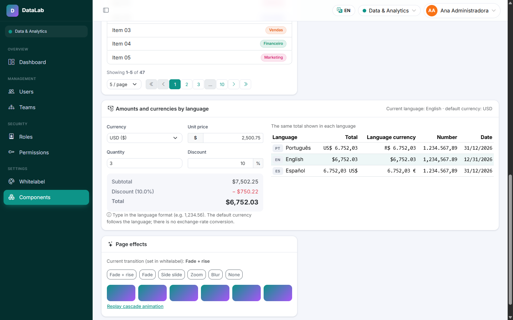

### Cadastro e confirmação de e-mail por código
- `/Account/Register`: cadastro público (nome, e-mail, senha com medidor de força, aceite de termos). A conta recebe o papel de `Account:DefaultRole`.
- `/Account/ConfirmEmail`: tela com 6 caixas para o código (colar e autopreenchimento funcionam), reenvio com contagem regressiva e tela de sucesso. Ao confirmar, o usuário já entra.
- Código numérico de 6 dígitos, válido por 15 minutos, 5 tentativas, 60 s entre reenvios (tudo configurável em `Account`). Só o hash fica no banco; um código novo invalida os anteriores.
- Quem tenta entrar sem ter confirmado (e com a senha certa) recebe um código novo e vai para a tela de confirmação.
- **Atalho de desenvolvimento:** em `Development` **e** sem provedor de e-mail configurado (`Pickup`, ou SMTP/SendGrid/Mailtrap sem credenciais), a tela mostra um quadro tracejado "Modo desenvolvimento" com o botão *"Confirmar sem código"*. Em qualquer outro ambiente o botão não aparece e o serviço (`EmailConfirmationService.DevAutoConfirmAsync`) recusa a chamada.

| Cadastro | Confirmação por código |
|---|---|
| 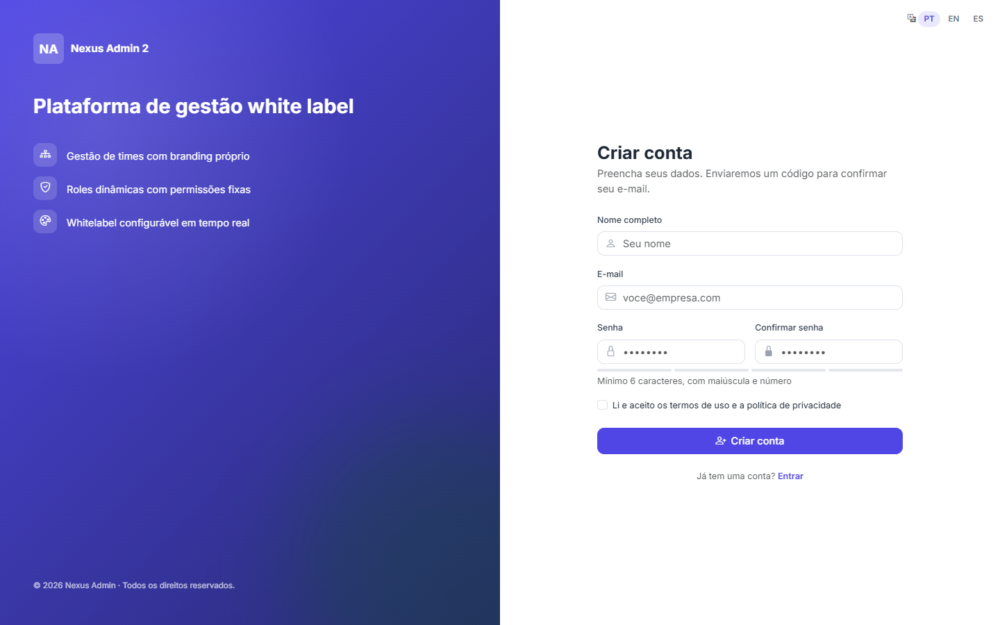 | 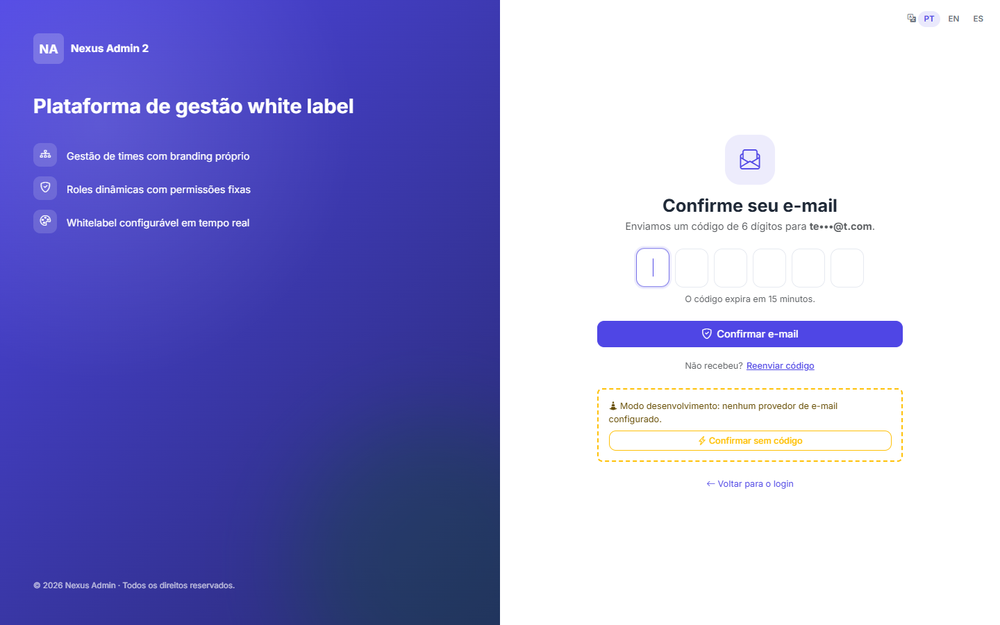 |

### Bloqueio de usuários
- Permissão `Users.Block`. Na listagem: ação por linha, em lote e no detalhe. Pede duração (1 h, 24 h, 7 dias, 30 dias ou indeterminado) e motivo.
- Usa o lockout do Identity e **encerra todas as sessões** do usuário na hora (SignalR + revogação no banco). O usuário recebe um e-mail com o motivo. No login, o motivo só aparece se a senha estiver correta.
- Bloqueio temporário: o fim é agendado no Hangfire, que avisa o usuário quando o acesso volta.
- Status "Bloqueado" e "Pendente" (e-mail não confirmado) na listagem, com filtros próprios. O bloqueio por excesso de tentativas de senha também aparece e pode ser desfeito.
- Inativar o usuário ou trocar a senha dele pelo editor também encerra as sessões abertas.

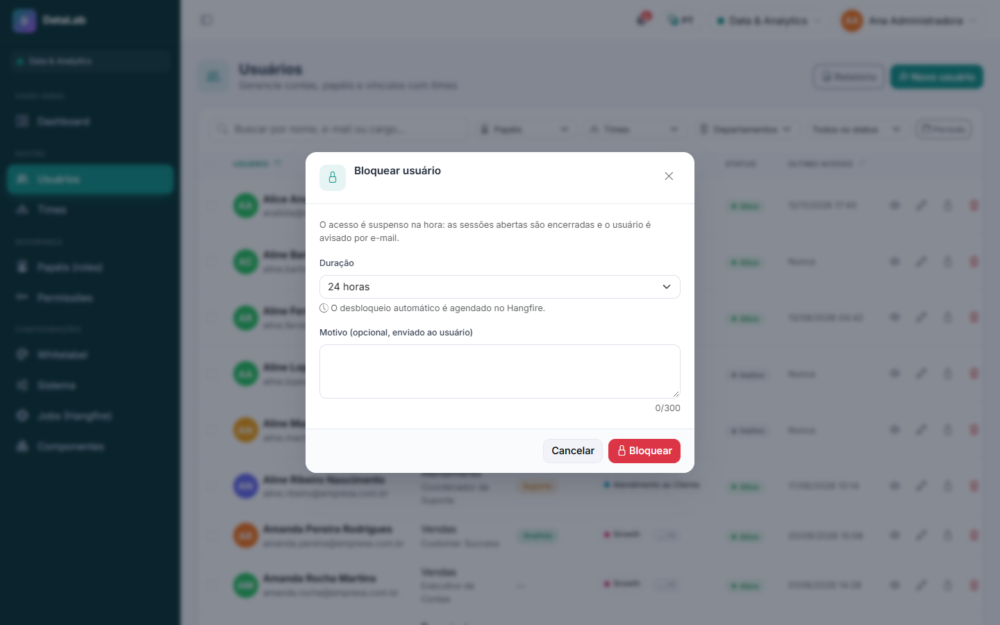

### Notificações (sistema + e-mail) em tempo real
- Sino no topo com badge de não lidas. A notificação nova chega pelo SignalR (`/hubs/notifications`): o sino balança, o badge pulsa e aparece um toast. Dá para marcar como lida, marcar todas e limpar as lidas.
- Eventos: novo cadastro (para quem tem `Users.Edit`), conta confirmada, entrada em um time, bloqueio/desbloqueio, alerta de excesso de tentativas de senha e **novo acesso à conta**.
- Publicação via `INotifier.Publish(new NotificationRequest { ... })`. A entrega (banco, SignalR e um e-mail por destinatário) roda no Hangfire.

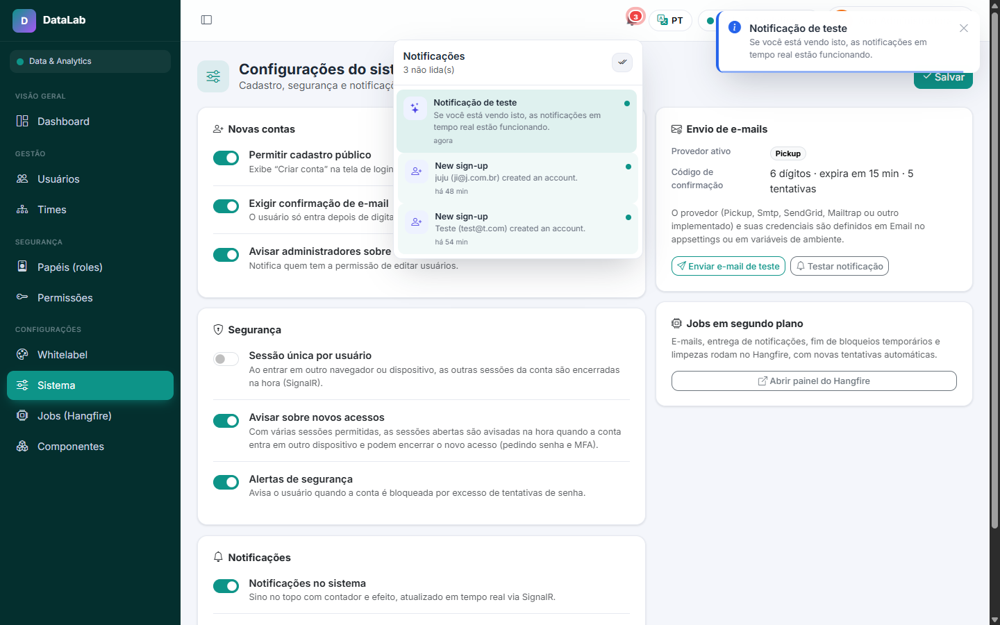

### Configurações do sistema (`/settings/system`, permissão `Settings.System`)
Opções que podem ser ligadas e desligadas: cadastro público, exigir confirmação de e-mail, avisar administradores sobre novos cadastros,
**sessão única**, **avisar sobre novos acessos**, alertas de segurança, notificações no sistema e notificações por e-mail.
A tela também mostra o provedor de e-mail ativo e tem "Enviar e-mail de teste" e "Testar notificação".

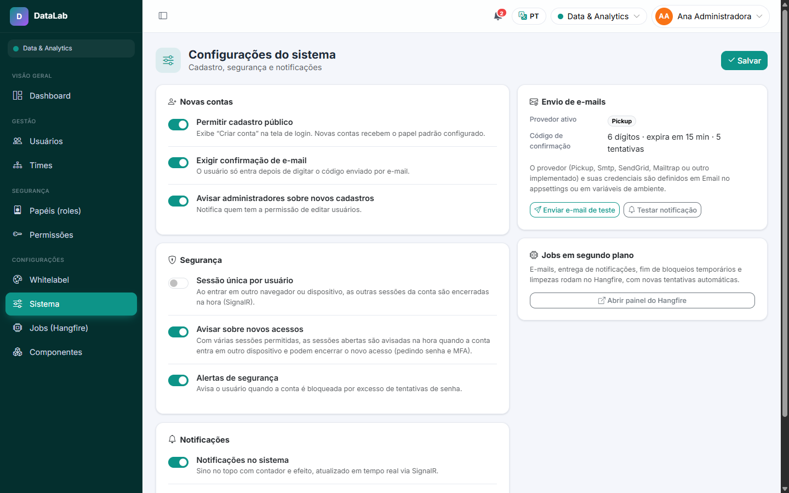

### Jobs em segundo plano (Hangfire)
Painel em `/jobs` (permissão `Jobs.View`). O armazenamento é SQLite, em `hangfire.db` separado do `app.db`. A fila `emails` tem prioridade sobre a `default`.

| Job | Tipo |
|---|---|
| Código de confirmação, e-mails de notificação, e-mail de teste | fire-and-forget, até 5 novas tentativas |
| Entrega de notificações (banco + SignalR + e-mails) | fire-and-forget |
| Fim de bloqueio temporário | agendado |
| Remover cadastros não confirmados (após 7 dias) | recorrente, diário às 3h UTC |
| Limpar códigos expirados | recorrente, de hora em hora |

### E-mail com qualquer provedor
`IMailSender` (usado pela aplicação) delega ao `IEmailProvider` escolhido em `Email:Provider`:
- `Pickup` (padrão): grava arquivos `.eml` em `App_Data/emails`, útil em desenvolvimento.
- `Smtp`: qualquer servidor SMTP, como Mailtrap Sandbox, Gmail, Office 365 ou Amazon SES SMTP.
- `SendGrid`: Web API v3 (`Email:SendGrid:ApiKey`).
- `Mailtrap`: Email API (`Email:Mailtrap:ApiToken`; o `Endpoint` aceita a URL de envio ou a do sandbox).

Para outro provedor (Postmark, Mailgun, Resend...), implemente `IEmailProvider` (`Name` + `SendAsync`), registre com `services.AddEmailProvider<MeuProvider>()` e configure `Email:Provider` com o nome dele. Guarde as credenciais em user-secrets ou em variáveis de ambiente (ex.: `Email__SendGrid__ApiKey`). Para os links dos e-mails, defina `App:PublicUrl` em produção.

`EmailOptions.IsDeliveryConfigured()` diz se há entrega real: `Pickup` ou um provedor sem credenciais conta como "não configurado" (é o que libera o atalho de confirmação em desenvolvimento).

## Segurança: sessões, dispositivos e MFA

### Sessões por dispositivo
Cada login cria uma linha em **`UserSessions`** (id da sessão, navegador, sistema, tipo de dispositivo, IP, criação, último acesso, se usou MFA e, quando encerrada, quando, por quê e por qual sessão).
O id vai no cookie como o claim `session_id`. Cada aba conectada ao SignalR grava o seu **connection id** em **`UserConnections`** e entra no grupo `session:{id}`,
o que permite derrubar exatamente aquele navegador. As conexões são removidas ao desconectar e zeradas quando o app inicia.

A cada requisição, `OnValidatePrincipal` confere a sessão (com cache de 2 min, limpo na revogação): sessão encerrada ou ausente → cookie rejeitado e redirecionamento ao login.

### Novo acesso: aviso em tempo real e "encerrar a outra sessão"
Com **várias sessões permitidas** (padrão) e *Avisar sobre novos acessos* ligado, quando a mesma conta entra em outro navegador:
1. as abas abertas recebem o evento `newSession` e mostram o aviso **"Novo acesso à sua conta"**, com navegador, sistema, IP e horário (vários avisos ficam em fila);
2. uma notificação de segurança também vai para o sino;
3. **"Fui eu"** fecha o aviso; **"Encerrar esta sessão"** pede **a senha de novo (e o código do MFA, se ativo)** antes de derrubar o outro navegador.

A sessão encerrada recebe `sessionRevoked` pelo SignalR e vai na hora para `/Account/SessionEnded`, com o motivo (encerrada por outro dispositivo, bloqueio, troca de senha...). O cookie dela não vale mais.

| Aviso na sessão original | Confirmação com senha (+ MFA) |
|---|---|
| 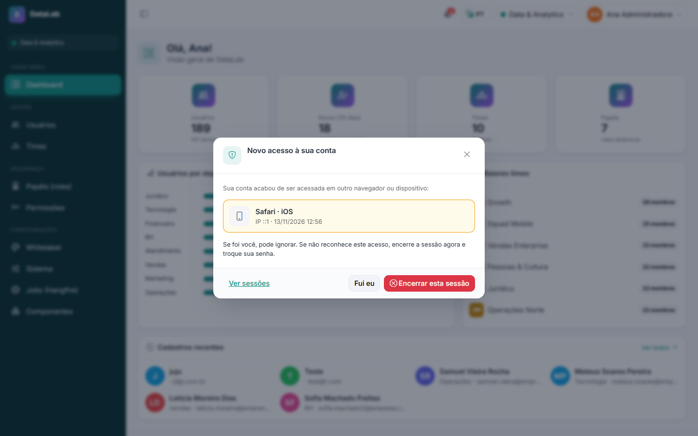 | 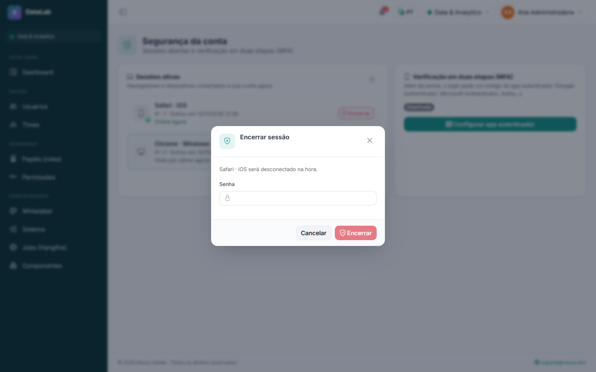 |

| Sessão derrubada (o outro dispositivo) |
|---|
| 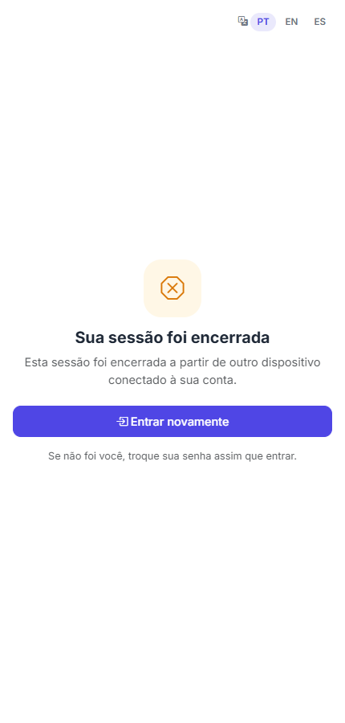 |

Com **Sessão única** ligada, não há aviso: o login novo encerra as outras sessões automaticamente (motivo *replaced*).

### Página "Segurança da conta" (`/account/security`)
Acessível pelo menu do usuário:
- **Sessões ativas**: ícone por tipo de dispositivo, "Esta sessão", ponto verde para quem está online (tem conexão SignalR), selo MFA, último acesso.
  Encerrar uma sessão ou **todas as outras** sempre pede a senha (e o código do MFA). A lista se atualiza sozinha.
- **Verificação em duas etapas (MFA)**: configurar, ver/regenerar códigos de recuperação e desativar.

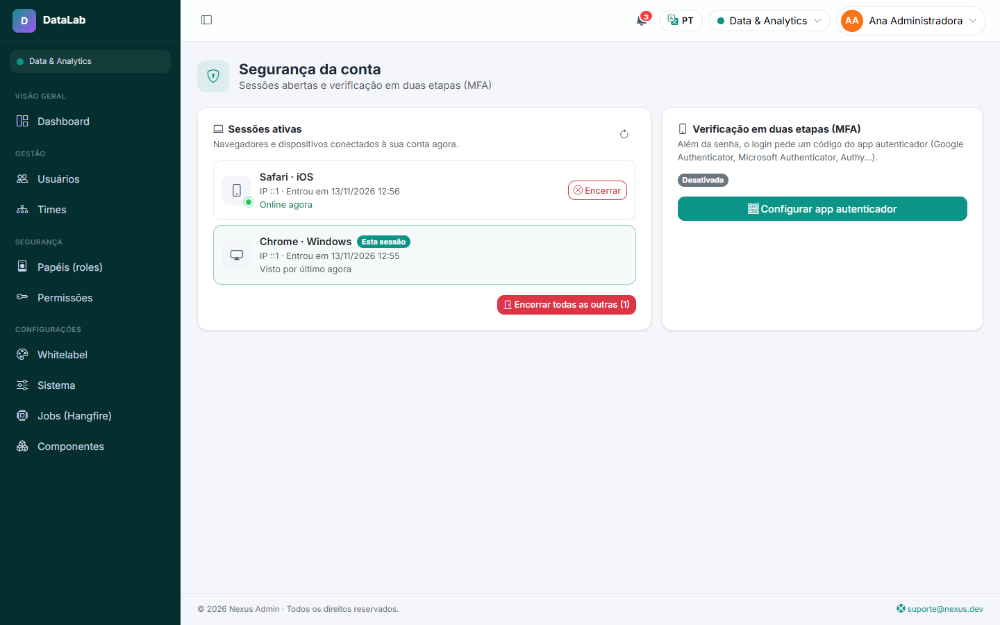

### MFA (TOTP com app autenticador)
- **Configuração:** QR code (gerado no servidor com QRCoder, sem chamadas externas) e a chave para digitar à mão. O emissor exibido no app é o nome do whitelabel.
  Para ativar, digita-se um código de 6 dígitos do app. Ao ativar, são gerados **10 códigos de recuperação** (`XXXXX-XXXXX`, uso único), que podem ser copiados ou baixados em `.txt`.
- **Ao ativar ou desativar**, as **outras** sessões são encerradas; a atual continua (o security stamp não é alterado, para não derrubar o circuito atual).
- **Login:** depois da senha, quem tem MFA vai para `/Account/LoginWith2fa` (6 caixas, ou "usar código de recuperação"). Erros contam para o lockout.
  A etapa intermediária fica num cookie próprio de curta duração; a sessão só é criada depois do código, marcada com MFA.
- **Desativar e regenerar códigos** pedem senha + código. Um administrador (`Users.Edit`) pode remover o MFA de um usuário pelo detalhe dele.

| Configuração (QR + chave) | 2ª etapa do login |
|---|---|
| 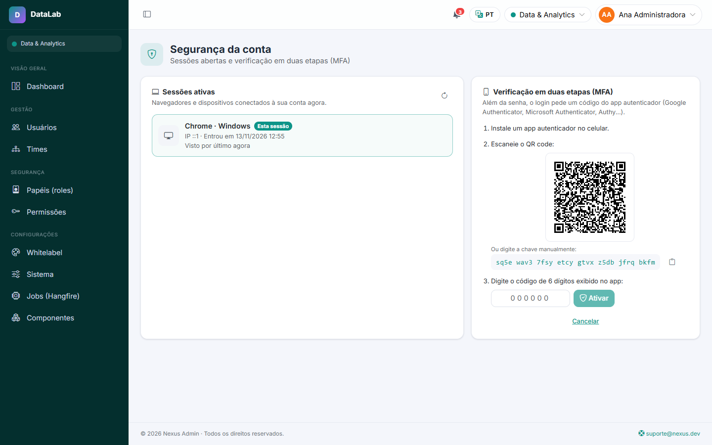 | 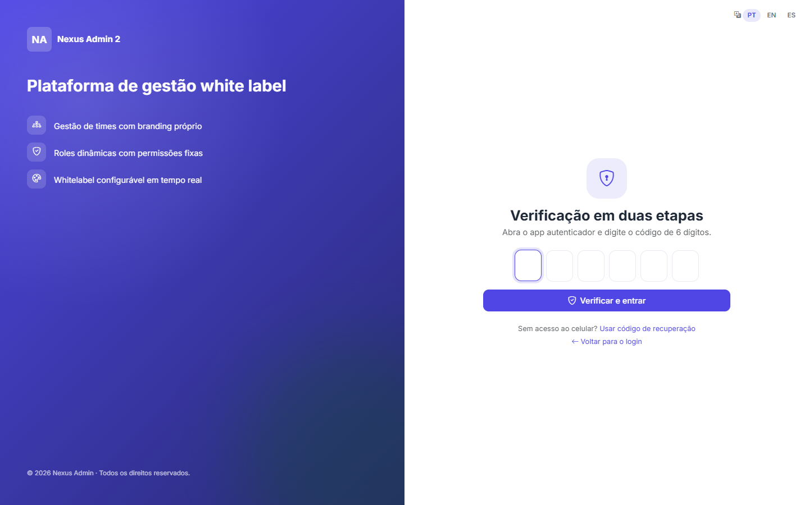 |

## Relatórios Excel e PDF

Botão **Relatório** na listagem de usuários (permissão **`Users.Export`**). O relatório usa **os mesmos filtros e a mesma ordenação da tela**.

O diálogo permite escolher:
- formato (**Excel `.xlsx`** ou **PDF**), título e subtítulo;
- **agrupar por** departamento, cargo ou status (ou sem agrupamento);
- incluir filtros aplicados e total de registros, linhas zebradas, logo e cores da marca;
- no PDF: orientação (retrato/paisagem) e papel (A4, Letter, Legal);
- **colunas**: marcar/desmarcar e **reordenar** (12 disponíveis: nome, e-mail, cargo, departamento, papéis, times, status, cadastro, último acesso, MFA, e-mail confirmado, motivo do bloqueio).

| Diálogo | PDF gerado (agrupado por departamento) |
|---|---|
| 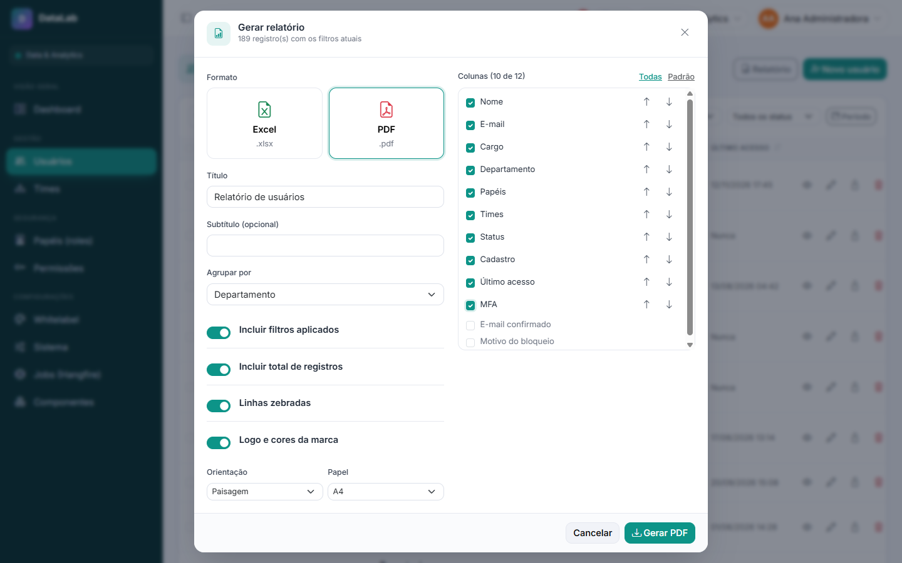 | 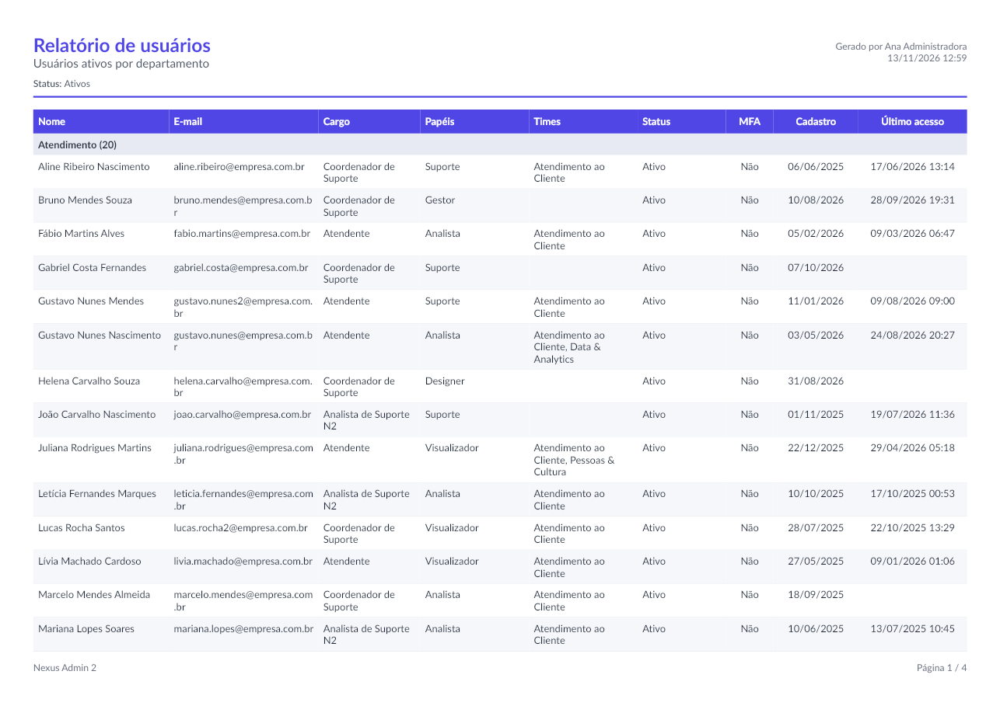 |

Detalhes:
- **Excel (ClosedXML):** datas e números com tipo de verdade (não texto), cabeçalho na cor da marca, linhas de grupo, zebra, autofiltro, cabeçalho congelado, largura automática e configuração de impressão.
- **PDF (QuestPDF):** cabeçalho com logo, título, filtros e "gerado por", tabela com cabeçalho repetido em cada página, grupos, zebra e "Página X / Y". A fonte se ajusta ao número de colunas.
- **Multiplataforma:** ambas as bibliotecas são .NET puro + SkiaSharp/OpenXML, sem Office, sem navegador headless e sem GDI. Funcionam em Windows, Linux (inclusive containers) e macOS.
- Geração fora da thread do circuito (`Task.Run`), limite de 50.000 linhas, download por `DotNetStreamReference` (`appFiles.download`), sem arquivo temporário no servidor.
- Para criar o relatório de outra tela: declare as colunas com `ReportColumn<T>` (veja `UsersReport.Columns()`), faça uma query que devolva os itens e chame `ReportService.RenderAsync(items, columns, options)`; o `ReportDialog` é genérico.
- **Licença do QuestPDF:** configurada como *Community* em `Program.cs` (gratuita para empresas com receita bruta anual abaixo de US$ 1 milhão). Acima disso é preciso uma licença paga.

## Como rodar

```bash
cd BlazorApp3
dotnet run --launch-profile https
```

Na inicialização as migrations pendentes são aplicadas (`Database.MigrateAsync()`) e, se o banco estiver vazio, o seed é executado. Para recriar do zero, apague `app.db` e rode novamente.

### Migrations

O `dotnet-ef` 11 está registrado como ferramenta local em `dotnet-tools.json` (rode `dotnet tool restore` uma vez). As migrations ficam em `BlazorApp3/Data/Migrations`.

```bash
cd BlazorApp3
dotnet ef migrations add NomeDaMudanca -o Data/Migrations   # após alterar entidades/AppDbContext
dotnet ef database update                                    # opcional: a app já aplica ao iniciar
dotnet ef migrations remove                                  # desfaz a última (se ainda não aplicada)
```

### Contas de demonstração (também listadas na tela de login, clique para preencher)

| E-mail | Senha | Papel |
|---|---|---|
| admin@demo.com | Admin@123 | Administrador (sistema, todas as permissões) |
| gestor@demo.com | Gestor@123 | Gestor |
| analista@demo.com | Analista@123 | Analista (somente leitura) |
| suporte@demo.com | Suporte@123 | Suporte |
| designer@demo.com | Designer@123 | Designer (whitelabel + componentes) |
| viewer@demo.com | Viewer@123 | Visualizador (apenas dashboard) |
| inativo@demo.com | Inativo@123 | Usuário inativo (login bloqueado) |

Os 180 usuários gerados pelo seed usam a senha `Demo@123`. Nenhuma conta vem com MFA ativo.

## Arquitetura

### Visão geral

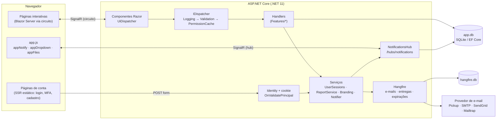

- **Dois canais SignalR:** o circuito do Blazor (interface) e o hub `/hubs/notifications` (eventos: `notification`, `newSession`, `sessionRevoked`). O hub é que sabe qual aba pertence a qual sessão.
- **Páginas de conta em SSR estático** (`[ExcludeFromInteractiveRouting]`, `AuthLayout`): precisam do `HttpContext` para gravar cookies.
- **Uma linha de execução por mensagem**: o `IDispatcher` cria um escopo de DI (e um `DbContext`) para cada query/command.

### Pastas

Cada arquivo `.cs` contém, em regra, **um único tipo** (classe, record, enum ou interface). As fatias maiores e novas de segurança agrupam os records de mensagem de um mesmo recurso num arquivo (`MfaFeature.cs`, `SessionsFeature.cs`).

| Pasta | Conteúdo |
|---|---|
| `Data/Entities/` | Uma entidade por arquivo (`AppUser`, `AppRole`, `Team`, `TeamMember`, `BrandingSettings`, `SystemSettings`, `UserSession` + `UserConnection`...) |
| `Data/` | `AppDbContext` (Identity), `DbSeeder`, `Migrations/` |
| `Security/` | `Perm` (catálogo fixo) e `PermissionDefinition` |
| `Security/Authorization/` | `HasPermissionAttribute`, `PermissionRequirement`, `PermissionPolicyProvider`, `PermissionHandler`, `PermissionService` (cache) |
| `Security/Identity/` | `UserSessions` (sessões, 2FA pendente, revogação), `DeviceInfo` (User-Agent), `SessionEvents`, revalidação do circuito, `AppClaimsPrincipalFactory`, `LocalizedIdentityErrorDescriber` |
| `Application/Cqrs/` | CQRS próprio (sem pacotes, só DI): `Abstractions/`, `Behaviors/`, `Dispatching/` |
| `Features/<Feature>/` | Fatias verticais: `Models/`, `Shared/`, `Queries/<Caso>/` e `Commands/<Caso>/` |
| `Features/Account/Security/` | `MfaFeature` (status, configurar, ativar, desativar, regenerar, resetar), `SessionsFeature` (listar, encerrar), `ReauthVerifier` |
| `Services/` | `Common/`, `Ui/` (`UiDispatcher`, `PagedQueryState`), `Toasts/`, `Loading/`, `Confirm/`, `Branding/`, `Files/` (`JsFileExtensions`), `Email/`, `Reports/` |
| `Services/Reports/` | `ReportModels` (colunas, opções, `ReportBuilder`), `ExcelReportWriter`, `PdfReportWriter`, `ReportService` |
| `Localization/` | `SharedResource`, `AppCultures`, `AppText`, `ValidationMessages`, `Money` |
| `Resources/` | `SharedResource.resx` (pt-BR), `.en.resx`, `.es.resx` |
| `Components/UI/` | Componentes reutilizáveis (`EditorBase<T>`, `PagedPager`, `MultiSelect`, `LazyAutocomplete`, `OutsideClickWatcher`, `ReauthDialog`, `ReportDialog`...) |
| `Components/Layout/` | `MainLayout`, `NavMenu`, `UserMenu`, `NotificationBell`, `SessionAlertHost` |
| `Components/Pages/` | Dashboard, Usuários, Papéis, Permissões, Times, Whitelabel, Sistema, Segurança da conta, Componentes |
| `Components/Account/` | Login, LoginWith2fa, Register, ConfirmEmail, SessionEnded (SSR estático) |
| `wwwroot/js/app.js` | Ponte JS: hub de notificações, dropdowns, download/cópia, efeitos |

Exemplo de caso de uso:

```
Features/Users/
├── Models/UserEditModel.cs, UserListItem.cs, ...
├── Shared/UserAssignments.cs
├── Queries/SearchUsers/SearchUsersQuery.cs + SearchUsersHandler.cs
├── Queries/ExportUsers/ExportUsersQuery.cs        (reaproveita filtros/ordenação do SearchUsers)
└── Commands/CreateUser/CreateUserCommand.cs + CreateUserHandler.cs
```

### CQRS (commands e queries só com DI)

- **Mensagens**: `IQuery<TResult>`, `ICommand<TResult>` e `ICommand` (que retorna `Unit`). Listagens herdam de `PagedQuery<TItem>` (Page/PageSize).
- **Handlers**: `IQueryHandler<,>` / `ICommandHandler<,>`, um handler por mensagem.
  `AddCqrs(assembly)` varre o assembly e registra tudo como *scoped* (inclusive handlers `internal sealed`).
- **`IDispatcher`** (singleton): cria **um escopo de DI por mensagem**, o que dá a cada query/command o seu próprio `DbContext`.
  Isso permite queries em paralelo no mesmo circuito Blazor. Os invokers tipados ficam em cache, e não há reflection por chamada.
- **Pipeline** (`IPipelineBehavior`, executados na ordem de registro):
  `LoggingBehavior` (tempo/erros), `ValidationBehavior` (DataAnnotations no servidor, inclusive em modelos aninhados),
  `PermissionCacheBehavior` (commands marcados com `IInvalidatesPermissions` limpam o cache de permissões).
  Mensagens que carregam senha sobrescrevem `ToString()`, então a senha não aparece no log.
- **Na UI**, o código que se repetia virou helpers:
  - `UiDispatcher.SendAsync`: loading + toast de sucesso/erro, retorna `CommandResult<T>`.
  - `UiDispatcher.DeleteAsync` / `ConfirmAndSendAsync`: confirmação + envio.
  - `Ui.Paged(query, StateHasChanged)` → `PagedQueryState<T>`: loading inicial/refresh, descarte de respostas obsoletas, `ApplyAsync` (filtro → página 1), paginação; `<PagedPager State="..."/>` se liga direto a ele.
  - `EditorBase<TModel>`: ciclo abrir → carregar → salvar → fechar → `OnSaved` dos editores (usuário, papel, time).

Para criar uma funcionalidade nova: crie a pasta do caso de uso, declare o `record` da query/command e o handler, e use `Ui.QueryAsync` / `Ui.SendAsync` na página. Não é preciso registrar nada.

### Idiomas (localization com resource files)
- **Configuração** (`Program.cs`): `AddLocalization(ResourcesPath = "Resources")` + `UseRequestLocalization` com pt-BR (padrão), en-US e es-ES (lista em `Localization/AppCultures.cs`).
  A cultura vem do cookie `.AspNetCore.Culture`, depois do `Accept-Language` e, por fim, do padrão. O circuito Blazor herda a cultura da conexão.
- **Troca**: `GET /culture/set?culture=en-US&redirectUri=/users` grava o cookie e redireciona (só aceita caminhos locais).
  O `LanguageSelector` usa links com `target="_top"`, então a página recarrega e o novo circuito já nasce no idioma escolhido.
- **Textos**: as páginas usam `@L["texto"]` (`IStringLocalizer<SharedResource>`, injetado em `_Imports.razor`).
  **A chave é o próprio texto em português**, então se faltar tradução aparece o original. Textos com valores usam placeholders: `L["Olá, {0}!", nome]`.
- **Fora dos componentes** (handlers, serviços, relatórios, `IdentityErrorDescriber`) usa-se `AppText.Get/Format`, que lê os mesmos `.resx`.
  Nas DataAnnotations, `ErrorMessageResourceType = typeof(ValidationMessages)`.
- **Novo texto**: use `L["..."]` no componente e adicione a mesma chave em `Resources/SharedResource.resx`, `.en.resx` e `.es.resx`.
  **Novo idioma**: crie `SharedResource.<cultura>.resx` e inclua a cultura em `AppCultures.All`.
- Dados cadastrados (nomes de times, departamentos, cargos, textos do whitelabel) não são traduzidos.

### Permissões e roles
- **Permissões** têm `Id` e `Nome` fixos em `Security/Perm.cs` e são sincronizadas com a tabela `Permissions` a cada inicialização. Para adicionar uma, crie a constante e inclua-a em `Perm.All`. A mais recente é `Users.Export` (Id 15), para os relatórios.
- **Roles** são criadas dinamicamente na tela *Papéis*, que oferece uma matriz de permissões agrupadas. A role de sistema `Administrador` sempre recebe todas.
- Uso em páginas: `@attribute [HasPermission(Perm.UsersView)]`. Em componentes: `<Can Permission="@Perm.UsersCreate">…</Can>`.
- As permissões são resolvidas no banco com cache invalidado a cada alteração, então mudanças em roles valem na hora, sem novo login.

### Whitelabel e times
- Em *Whitelabel* você configura nome, slogan, logo, favicon, cores (com temas prontos), fonte, arredondamento, transição de página, textos do login e do rodapé, e-mail de suporte, além de permitir ou não o branding por time. Há pré-visualização ao vivo.
- Cada **time** pode ter branding próprio: nome exibido, logo e cores. Ao escolher o time no seletor do topo, a aplicação inteira assume a identidade dele.

### Componentes
Toasts, loading global, spinner, skeleton, botão com loading, Modal (central), Drawer (lateral), confirmação de exclusão (simples ou exigindo digitar o nome), confirmação com senha + MFA (`ReauthDialog`), diálogo de relatório (`ReportDialog`), upload (drag & drop, vários arquivos, progresso), upload de imagem com preview, paginação, busca com debounce, autocomplete lazy paginado, lista virtualizada, multi-select, ordenação por coluna, chips de filtros e transições de página. A maioria pode ser testada em **/components**.

Os uploads ficam em `App_Data/uploads` e são servidos em `/uploads`.

## Fluxos de código

### Uma ação na tela (CQRS)

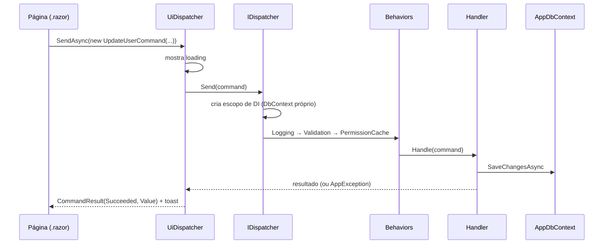

### Login com senha, MFA e criação da sessão

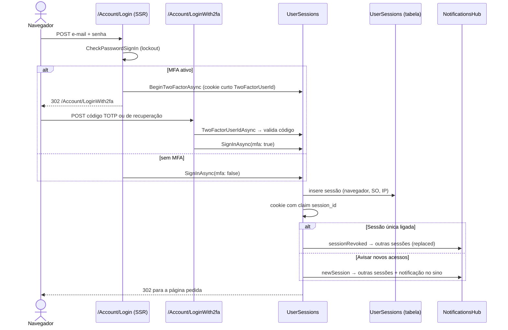

### Encerrar outra sessão (com reautenticação)

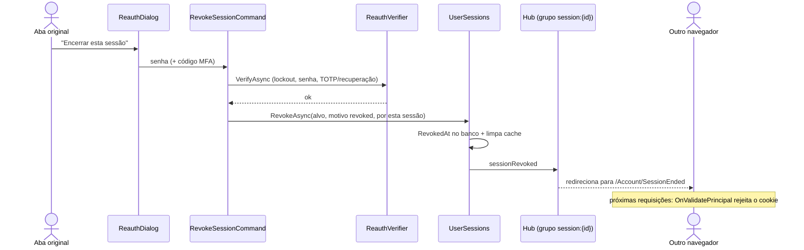

### Gerar relatório

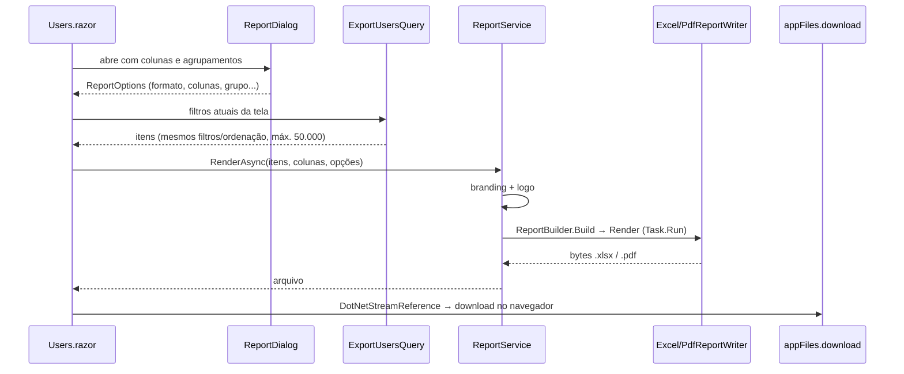

### Implementação: decisões importantes
- **Sessão no banco, não só no cookie:** permite listar, encerrar uma específica e auditar quem encerrou qual. A validação usa cache curto para não consultar o banco a cada requisição.
- **Claims preservados na renovação:** `SecurityStampValidatorOptions.OnRefreshingPrincipal` copia `session_id` e `amr` quando o Identity recria o principal, senão a sessão "sumiria".
- **MFA sem trocar o security stamp:** ativar/desativar usa as APIs de store do Identity e encerra as outras sessões explicitamente; trocar o stamp derrubaria também o circuito atual.
- **Reautenticação centralizada:** `ReauthVerifier` é usado por encerrar sessão, desativar MFA e regenerar códigos; respeita o lockout do Identity.
- **Dropdowns sem camada invisível:** o "clique fora" é detectado em JS (pointerdown em captura), o que devolve a rolagem por roda/toque dentro de drawers e modais.
- **Relatório reaproveita a busca:** `ExportUsersQuery` chama os mesmos `Filter`/`Sort`/`LoadBadges` do `SearchUsersHandler`, então o arquivo bate com a tela.

## Pacotes usados

### Back-end (NuGet)

| Pacote | Versão | Para quê |
|---|---|---|
| `Microsoft.AspNetCore.Identity.EntityFrameworkCore` | 11.0.0 | Usuários, papéis, senha, lockout, tokens e TOTP |
| `Microsoft.EntityFrameworkCore.Sqlite` | 11.0.0 | ORM e banco SQLite (`app.db`) |
| `Microsoft.EntityFrameworkCore.Design` | 11.0.0 | Migrations (`dotnet ef`) |
| `Microsoft.AspNetCore.Components.WebAssembly.Server` | 11.0.0 | Hospedagem do projeto `BlazorApp3.Client` |
| `Hangfire.AspNetCore` | 1.8.25 | Jobs em segundo plano e painel `/jobs` |
| `Hangfire.Storage.SQLite` | 0.4.3 | Armazenamento dos jobs em `hangfire.db` |
| `SQLitePCLRaw.lib.e_sqlite3` | 3.53.3 | **Correção de segurança** (veja abaixo) |
| `ClosedXML` | 0.105.1 | Relatórios Excel (`.xlsx`) |
| `QuestPDF` | 2026.9.2 | Relatórios PDF (licença Community) |
| `QRCoder` | 1.8.1 | QR code do MFA, gerado no servidor |

Também do framework (sem pacote extra): ASP.NET Core SignalR, localização (`IStringLocalizer`), Data Protection e `System.Net.Mail` (provedor SMTP).
Ferramenta local: `dotnet-ef` 11 (`dotnet-tools.json`).

**Correção do SQLite nativo:** o `Hangfire.Storage.SQLite` → `sqlite-net-pcl` → `SQLitePCLRaw.bundle_green` 2.1.11 trazia o `SQLitePCLRaw.lib.e_sqlite3` 2.1.11 (GHSA-2m69-gcr7-jv3q).
O `.csproj` fixa a versão 3.53.3 com `ExcludeAssets="all"`, então o processo usa um único `e_sqlite3` nativo, o corrigido que vem com o EF Core. `dotnet list package --vulnerable --include-transitive` fica limpo. Revise ao atualizar o Hangfire.Storage.SQLite.

### Front-end

| Biblioteca | Versão | Origem | Para quê |
|---|---|---|---|
| Blazor Web (`blazor.web.js`) | .NET 11 | framework | Circuito Interactive Server e navegação melhorada |
| Bootstrap | 5.3.8 | `wwwroot/lib` | Grid, utilitários e formulários (tema próprio em `app.css`) |
| Bootstrap Icons | 1.11.3 | CDN jsDelivr | Ícones |
| `@microsoft/signalr` | 8.0.7 | CDN jsDelivr | Cliente do hub de notificações/sessões |
| Google Fonts | — | fonts.googleapis.com | Fonte escolhida no whitelabel |
| `wwwroot/js/app.js` | próprio | — | `appNotify` (hub, sino, avisos de sessão), `appDropdown` (clique fora + rolagem), `appFiles` (download e cópia), efeitos e helpers |

Não há bundler nem `node_modules` na aplicação. O Node (20+) só é usado pelo script de prints.

## Atualizando os prints

O script `tools/screenshots.mjs` não tem dependências. Ele controla o Chrome pelo DevTools Protocol, usando o WebSocket nativo do Node 20+.
Ele força `Accept-Language: pt-BR` (os seletores procuram textos em português) e usa contextos isolados do Chrome para simular um segundo dispositivo
(um "iPhone" entra na mesma conta para gerar o aviso de novo acesso e depois é derrubado).

```bash
# 1) app rodando em http://localhost:5299   2) Chrome headless com depuração remota
dotnet run --project BlazorApp3 --urls http://localhost:5299
chrome --headless=new --remote-debugging-port=9222 --user-data-dir=%TEMP%\shots-profile
# 3) captura (opcional: lista de nomes para capturar só alguns, ex.: 03-usuarios,17-menu-meus-times)
node --experimental-websocket tools/screenshots.mjs docs/screenshots
```

Variáveis opcionais:

| Variável | Uso |
|---|---|
| `BASE` | URL do app (padrão `http://localhost:5299`) |
| `PENDING_EMAIL` | conta com e-mail não confirmado, para o print `26-confirmar-email` |
| `MFA_EMAIL` / `MFA_PASSWORD` | conta com MFA ativo, para o print `37-login-mfa` |

O print do PDF (`38-relatorio-pdf.png`) é gerado com `PdfReportWriter.Create(doc).GenerateImages(...)` do QuestPDF, a partir dos dados do seed.
O script cria sessões e notificações de teste para o admin; se quiser um ambiente limpo depois, encerre as sessões em **Segurança da conta**.
